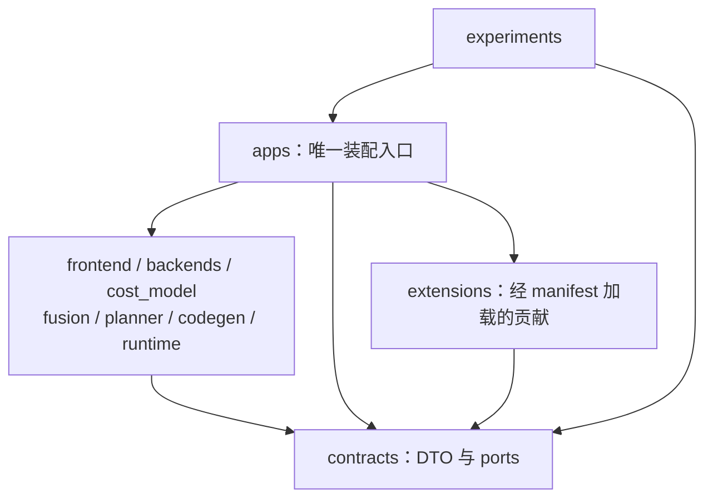

# 模块依赖与修改边界

状态：初始架构约束。本文约束未来实现及 AI 任务分工；当前没有导入检查器、CI 或访问控制实现，不把提示词当作技术隔离。

## 1. 允许的源码依赖

依赖方向以“使用方导入提供方”为准：

| 使用方 | 可导入本仓库的内容 |
|---|---|
| `modules/contracts` | 自身公开/内部代码；不得依赖其他模块或 apps |
| `modules/frontend` | 自身代码、contracts 公开 API |
| `modules/backends` | 自身代码、contracts 公开 API |
| `modules/cost_model` | 自身代码、contracts 公开 API |
| `modules/fusion` | 自身代码、contracts 公开 API |
| `modules/planner` | 自身代码、contracts 公开 API |
| `modules/codegen` | 自身代码、contracts 公开 API |
| `modules/runtime` | 自身代码、contracts 公开 API |
| `apps` | 上述模块公开 API；仅统一插件加载器可按已校验 manifest 解析扩展工厂 |
| `modules/experiments` | 自身代码、contracts 公开 API、apps 提供的公开实验运行入口 |
| `extensions/<kind>/<plugin_id>` | 自身代码、contracts 公开 API；可声明第三方依赖，不导入核心模块、apps 或兄弟扩展实现 |

模块可使用经过声明的外部依赖，但不得借外部包或动态导入绕过本表。contracts 不引入 NumPy、PyTorch、CUDA、RPC、数据库客户端等重依赖，也不执行探测、加载模型或连接网络等副作用。

experiments 需要对某算法做独立评价时，由 apps 暴露注入或运行入口；不要直接导入算法模块内部类。模块自己的单元测试可以测试该模块内部实现，但不能借测试代码修改或绑定其他模块内部细节。

图中的模块组是依赖规则的汇总节点，不表示应实现一个包含所有模块的大类。

## 2. 通过端口协作，不互相导入实现

合法例子：

- fusion 接收 contracts 定义的预测端口。apps 注入 cost_model 提供的实现。
- codegen 接收编译、验证执行与产物存储端口。apps 注入 backend 和 runtime 的实现。
- runtime worker 接收设备执行端口。apps 选择并注入 CPU/GPU backend。
- planner 接收完整快照及连接查询端口，不读取 cost_model 的内部训练对象。

不合法例子：

- fusion 导入 `cost_model/.../predictor_impl`，或 planner 导入 fusion 的候选缓存内部类。
- runtime 在执行失败时直接调用 planner 或 codegen，静默生成不同计划。
- backends 导入 frontend 的模型对象并跳过规范化语义图。
- contracts 暴露某个框架的 Tensor、CUDA stream 或数据库连接作为跨模块 DTO。
- 通过字符串模块路径、`importlib`、全局 Service Locator 或环境变量读取另一个模块内部对象。

唯一动态加载边界是 apps 中统一的插件加载器：依据 [扩展契约](../../modules/contracts/extensions.md) 读取已校验 manifest，解析该包声明的工厂。它不能成为任意模块导入邻居内部实现的通道。核心模块仅接收窄接口，不导入 extensions；apps 不按每个插件写导入列表。该加载器尚未实现。

端口协议由 contracts 拥有，具体类由实现模块拥有。协议需要更改时，必须作为明确的契约变更处理；不能在使用方建立一份不兼容的同名协议。

## 3. 数据依赖与反馈不构成导入环

系统可以存在“预测→候选→规划→实现优化→新预测”的迭代，但其实现是 apps 组织的多轮记录交换：

1. apps 冻结候选、代价、设备和环境快照 e。
2. planner 只读取 e，输出引用 e 的计划。
3. runtime 或 codegen 返回新结果，不修改 e。
4. apps 进行接纳检查，再组织 e+1。

任何模块不得持有指向其他模块内部可变状态的引用，借回调修改对方缓存或记录。传递的是契约数据、不可变标识与明确端口；序列化方式由协议层决定。

## 4. 文件所有权

模块所有权默认覆盖 `modules/<module>/` 下的实现、模块专属测试和模块文档。其他模块可读，不因“顺手修复”而自动获得写权限。

| 文件类别 | 所有权和默认修改条件 |
|---|---|
| 模块代码、模块测试、模块内部文档 | 该模块任务可修改 |
| contracts 的 DTO、ports、状态和序列化约定 | 仅明确包含 contracts 的任务可修改 |
| apps 的装配、入口和任务流程 | 仅明确包含 apps 的任务可修改 |
| 根提示词、模块提示词、架构规则 | 治理文件；普通实现任务不能修改规则来扩大自身范围 |
| 共享实验配置和跨模块集成用例 | 明确的实验/集成任务所有，不由任意业务模块任务改写 |
| `extensions/<kind>/<plugin_id>/` | 普通扩展任务只修改已授权单包；所有提示词及治理规则仍只读 |
| backends 的通用编译/执行机制 | 属于核心 backends 任务；新增具体设备/编译器默认进入 extensions，不复制通用机制 |

文件路径的最终允许范围以当前任务声明和上级提示词为准。用户明确授权的跨模块任务可以同时修改多个范围；不能把本规则解释成必须重复请求已经取得的授权。

## 5. 跨模块变更流程

跨模块修改必须明确而可审查，不应通过放宽一条模块提示词解决依赖问题。

变更说明至少回答：

1. 当前接口缺少什么？能否在既有公开契约内完成？
2. 哪个模块拥有契约，哪些模块生产和消费它？
3. 字段、单位、默认值、错误状态或版本发生什么变化？
4. 旧快照、已编译产物和旧计划是否仍可读取？不兼容时如何明确拒绝或迁移？
5. 需要修改哪些精确路径，怎样验证各方一致？

若原任务只授权单模块，先完成不依赖外部改动的工作并说明阻塞接口，提出具体跨模块范围；不得创建影子字段、复制对方实现或在运行时猜测兼容。若任务已授权必要跨模块工作，则按声明的范围执行并在结果中列出影响，不额外设置重复审批。

## 6. 状态与数据的所有权

- frontend 拥有导入和规范化结果的产生过程，不拥有后续计划的修改权。
- fusion 拥有候选集合的产生过程，不决定最终设备映射。
- planner 拥有计划生成过程，不拥有成本测量真值。
- codegen 拥有新程序的生成过程，不拥有原接口的修改权。
- runtime 拥有执行状态和原始观测，不拥有研究算法的重规划决策。
- cost_model 拥有预测和校准模型，不覆盖原始观测。
- experiments 拥有评价配置和分析结果，不用修改被评价算法来改变实验结论。
- apps 拥有跨阶段生命周期和预算协调，不重新实现上述算法。

所有权不等于可以覆盖历史记录。已被快照、计划或报告引用的数据应保持可追溯。

## 7. 未来检查与当前证据

未来实现代码后，建议加入静态导入边界检查、任务允许路径 diff 检查、契约兼容测试和跨模块集成验证。检查应覆盖别名导入、动态加载和从测试绕过边界的情况。

当前仅初始化文档，因此本轮只应声称完成目录、文档、链接及边界一致性检查。不能写“导入检查已通过”“CI 已阻止跨模块修改”或“提示词保证 AI 不会越界”。CODEOWNERS、分支规则和检查器只有实际配置并验证后才能作为强制门禁证据。
