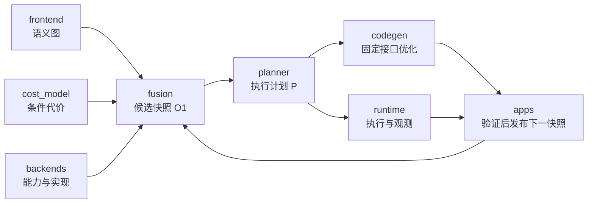

# OpFusion 系统架构

状态：架构初始化规格。当前仓库没有业务实现；文中接口、运行角色和流程是实现约定，不代表代码、CI、远程执行或性能结果已经存在。

## 1. 系统目标与首版边界

OpFusion 面向异构分布式推理，将图级融合、异构映射调度和设备内程序优化连接为一条可验证的执行流程。系统以静态 shape、无控制流的算子 DAG 为起点，每个融合区域的一次执行位于一个设备实例，区域之间采用完整张量依赖。当前不涉及光计算。

原始图节点只表示逻辑算子；边携带生产者输出端口、消费者输入端口和张量标识。逻辑张量、具体物理表示、设备缓冲和执行事件分别记录。图上合并节点不能作为物理融合或性能改进的证据。

首版采用模块化单仓库。算法和控制面默认使用 Python；已有编译器、库和必要的 native 实现通过后端适配器接入。不会为每个研究模块独立建立微服务，也不预先绑定 RPC 库、分布式数据库或集群管理平台。

## 2. 模块与研究分工

九个模块位于 `modules/`；`apps/` 是唯一装配入口，不是第十个算法模块。

| 模块 | 输入 | 输出 | 责任边界 |
|---|---|---|---|
| `contracts` | 稳定领域语义与跨模块交互要求 | 纯 DTO、枚举、单位、版本、端口协议和接口级校验约定 | 不执行 I/O，不持有可变全局注册表，不实现预测、搜索或硬件操作 |
| `frontend` | 外部模型、参数描述、shape、数值政策 | 规范化算子图、张量表、来源映射和导入诊断 | 负责语义导入；不决定融合边界、设备或程序实现 |
| `backends` | 设备配置、区域/接口、编译或执行请求 | 能力快照、支持结论、默认实现、编译产物及设备执行/转换结果 | 硬件类型在 contracts 定义；实际探测和支持检查由本模块负责 |
| `cost_model` | 区域、接口、实现描述、设备快照、已有测量及预算 | 条件代价预测、特征、不确定性及校准模型版本 | 负责研究一的成本建模；不直接采集硬件数据、不生成划分 |
| `fusion` | 语义图、能力/实现查询、成本查询及搜索预算 | 完整候选划分、区域接口、候选保留结果和候选快照 O₁ | 负责研究一的图级融合；不做最终映射、不搜索任意线程或 tile 结构 |
| `planner` | 固定 O₁ 快照、部署环境 J、连接/适配器信息 | 选中划分、候选、传输、事件和缓冲的执行计划 P | 负责研究二；不编译、不执行、不篡改候选代价 |
| `codegen` | 固定区域、设备、接口、参考实现、工作区和调优预算 | 新实现、编译产物引用、验证和成本记录，或范围明确的失败原因 | 负责研究三；不静默改区域边界、输出集合或部署计划 |
| `runtime` | 固定执行计划、产物引用、运行环境 | 执行状态、输出引用、资源事件及原始观测 | 按计划执行；不自行融合、调优或重规划 |
| `experiments` | 实验配置、固定候选/预算、运行入口和观测 | 正确性、性能、排序与选择损失等可追溯评估 | 不成为生产执行依赖，不改算法实现以迎合实验 |

`apps/` 解析任务与配置，实例化并注入各模块，管理总预算、版本快照及接纳/回退流程。它可以调用模块公开 API，但不能复制模块内部算法。所有算法模块对外交换 contracts 定义的对象，不直接导入其他算法模块的具体实现。

下列是逻辑调用关系，不是模块之间的源码导入关系：

反馈箭头表示新一轮数据更新。单轮执行仍读取固定快照，不能形成边规划边改变成本的隐式循环。

## 3. 两个运行角色

### 3.1 协调端

协调端由 `apps/` 中的入口装配。它组织前端、研究算法和 runtime coordinator，负责：

- 接收任务及数值、资源、测量约束；固定输入驻留和输出交付要求。
- 生成或选择候选快照，调用 planner，检查产物和快照引用。
- 提交执行、汇集状态、处理取消或失败，决定是否请求下一轮优化。
- 统一管理总编译、调优和测量预算。

研究算法与 coordinator 可以先在同一进程内运行。后续是否需要单独服务，应由真实并发负载和故障隔离需求决定。

### 3.2 工作端

工作端同样由 `apps/` 的入口装配 runtime worker、传输适配器和本机 backend。它负责：

- 检查请求版本、运行标识、产物、设备能力和资源条件。
- 通过 backend 完成设备分配、执行、转换和同步，处理本机缓冲生命周期。
- 返回事件、输出引用、失败原因和原始测量；保留请求与观测的关联。

工作端不选择图划分，不调用 planner 修复全局计划，不运行未经请求的调优搜索。若实际环境与计划不符，返回可识别状态，由协调端决定是否重新规划。

### 3.3 runtime 内部职责

`coordinator`、`worker`、`transport` 和 `artifact store` 是 runtime 内部边界，当前不拆成四个服务：

| 职责 | 内容 | 不负责 |
|---|---|---|
| coordinator | 计划提交、任务/尝试标识、状态汇集、取消和执行级错误传播 | 图融合、代价学习、算法级重规划 |
| worker | 本机执行、事件和资源管理 | 全局候选选择 |
| transport | 控制消息和数据传输的协议实现、超时和连接错误 | 推断计算语义或修改计划 |
| artifact store | 按不可变标识保存和取得程序产物、清单与观测引用 | 选择哪个实现更快 |

DTO 和端口由 contracts 定义，具体存储实现由 runtime 提供。codegen 等模块通过注入端口保存产物，不导入 runtime 的存储类。内存/文件存储足以支撑早期原型；远程共享存储待实际需求出现后再引入。

RPC 与跨主机数据传输的具体库，在第一个跨主机实现前通过 ADR 决定。现在只固定请求、状态、错误、版本、超时和重试含义，不声称网络协议已经实现。

## 4. 共享契约和不可变记录

以下名称表示跨模块对象类别，具体字段和 API 由 contracts 所有权范围维护：

| 对象类别 | 必须表达的事实 |
|---|---|
| 语义图、张量及端口边 | 节点/张量标识、操作数顺序、shape、数值语义与来源 |
| 设备/资源快照 | 实例、内存池、互联、后端版本、配置和支持条件 |
| 区域与边界接口 | 成员、必须保留的输出、物理表示、数值政策、就绪和所有权要求 |
| 实现候选及证据 | 区域、设备、接口、代码/后端版本、验证范围和状态 |
| 成本记录 | 预测与实测分别保存，单位、计时边界、工作区、适用条件和来源完整 |
| 适配器与连接关系 | 两端表示、访问条件、合法转换/复制及其资源需求 |
| 部署环境 J | 输入/参数初始位置、输出目标、可用容量、线程/并发和计时口径 |
| 执行计划 P | 固定快照、完整候选选择、事件/资源顺序、缓冲和产物引用 |
| 优化请求与结果 | 固定区域、设备、接口、预算、参考程序及结果版本 |
| 执行与测量记录 | run/task/attempt 关联、状态、原始观测、时钟域和失败原因 |

不可变记录的修订产生新标识或新版本，不原地覆盖旧计划引用的数据。未知、未测、明确不支持、当前实现失败和预算内未找到必须区分；不可把缺失字段填成零或把搜索失败当作不可行证明。

## 5. Conv＋BiasAdd＋ReLU 的完整工程流程

1. frontend 导入三节点语义图：`Conv2D(X,W)→T1`、`BiasAdd(T1,b)→T2`、`ReLU(T2)→Y`。Conv 本身不含 bias；边保留端口与 T1/T2 标识。
2. backends 查询各设备上的默认实现和支持范围。默认程序为初始可执行见证，不意味着已经有单内核融合。
3. cost_model 返回带设备、接口、实现和执行条件的预测。已测记录与预测记录分开。
4. fusion 构造不融合、Conv＋BiasAdd、BiasAdd＋ReLU、全融合等完整候选划分，检查覆盖、商图无环及输出保留，形成候选快照内容；apps 统一验证引用并通过 SnapshotStorePort 发布不可变快照 e。
5. planner 读取快照 e 和 J，选择具体候选以及输入上传、必要转换、输出回传、缓冲和事件计划。
6. runtime 检查产物和环境，执行计划并返回观测。区域完成前不向下游暴露尚未满足接口的输出。
7. apps 可向 codegen 发出固定区域、设备和接口的优化请求。codegen 通过 backend/执行端口生成并验证程序，不修改原图或 planner 的计划。
8. apps 将合格新记录组织为快照 e+1，再请求 fusion/planner 重评。失败或无收益时保留可行旧方案；总预算限制轮数。

若另一个算子需要 T1，全融合区域必须把 T1 加入边界输出。codegen 不能只返回 Y；cost_model 也不能复用“只输出 Y”的成本。这个约束从 frontend 的语义关系经 contracts 一直传递到 runtime。

## 6. 执行、验证和测量边界

- 首版跨区域输入只读，不允许未声明的原地覆盖；内部复用由具体实现验证。
- 调用方提供的输出缓冲在区域启动前分配。工作区按内存池覆盖整个区域执行区间保守保留；适配器遵守同样的记账规则。
- 缓冲直到所有读取和相关传输完成才能释放。同一物理分配只记账一次。
- 未建立争用模型时，同设备计算采用保守串行规则；复制重叠需要明确资源能力和测量依据。
- 单区域正确性测试不自动证明组合数值满足要求，完整模型输出仍须验证。
- 本机耗时使用记录明确的时钟和计时协议；不同主机的时间戳不能未经校准直接相减当作精确延迟。事件因果关系与物理时钟需要分别记录。
- 重试和重复消息要有 run/task/attempt 语义；当前不承诺网络层“恰好一次”执行。
- 评价研究一时固定实现来源和调优预算；评价研究三时固定区域和接口。全部编译、测量与搜索成本要可归因。

## 7. 交付与演进顺序

当前交付是模块、契约和提示词规范。后续建议按依赖推进：

1. contracts 与 Conv 示例的可校验数据表示。
2. frontend 语义导入、一个成熟 CPU/backend 的默认实现，以及本地 runtime 闭环。
3. 固定默认实现下的 cost_model、fusion 和 planner 基线。
4. 独立 worker 协议和单机多设备验证；跨主机前完成 RPC/传输 ADR。
5. codegen 的固定接口优化与版本化反馈。
6. 分布式运行、故障边界和实验对照。

每一步都应有真实执行或检查证据。目录存在、接口文档或模拟结果不能被写成系统已经支持某设备、跨主机执行或性能加速。
